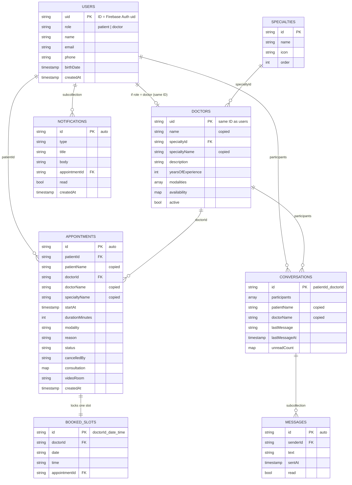

# MediCare App — Modelo de datos (con Firestore)

> Responsable: **Elvis**. Cualquier cambio a nombres de colecciones o campos se discute en grupo y se actualiza aquí antes de programarlo.
>
> **Convención:** todo lo que es código o base de datos va en **inglés** (colecciones, campos, valores fijos, funciones). Solo el texto que ve el usuario en pantalla va en español.

## 1. Cómo pensar en Firestore (NoSQL)

- No hay tablas ni `JOIN`. Hay **colecciones** de **documentos** (parecidos a JSON).
- Una consulta lee **una sola colección**. Por eso se **copian algunos datos** (por ejemplo, el nombre del médico dentro de la cita) para que una lista se muestre sin leer otros documentos. A esto se le llama *desnormalizar* y es lo normal en Firestore.
- Las relaciones se guardan como **IDs** (texto) que apuntan a otro documento.
- Cada lectura de documento cuenta para la cuota gratis (50,000 al día), así que evitamos lecturas extra.

## 2. Diagrama de colecciones



Estructura de rutas:

```
users/{uid}
users/{uid}/notifications/{notificationId}
specialties/{specialtyId}
doctors/{uid}
appointments/{appointmentId}
bookedSlots/{doctorId_date_time}
conversations/{patientId_doctorId}
conversations/{patientId_doctorId}/messages/{messageId}
```

## 3. Valores fijos (enums)

Se guardan en Firestore en inglés y en minúsculas. La app los traduce al español solo para mostrarlos.

| Campo | Valores en Firestore | Texto en pantalla |
|---|---|---|
| `role` | `patient`, `doctor` | Paciente, Médico |
| `status` | `scheduled`, `completed`, `cancelled` | Programada, Completada, Cancelada |
| `modality` | `in_person`, `video_call` | Presencial, Videollamada |
| `cancelledBy` | `patient`, `doctor` | — |
| `type` (notificaciones) | `reminder`, `appointment_booked`, `appointment_cancelled`, `new_message` | — |

En Dart conviene definirlos como `enum` en `lib/models/`, por ejemplo:

```dart
enum AppointmentStatus { scheduled, completed, cancelled }

extension AppointmentStatusLabel on AppointmentStatus {
  String get label => switch (this) {
        AppointmentStatus.scheduled => 'Programada',
        AppointmentStatus.completed => 'Completada',
        AppointmentStatus.cancelled => 'Cancelada',
      };
}
```

"Hoy" y "Mañana" **no son estados**: la app los calcula a partir de `startAt` para mostrar el chip.

## 4. Colecciones en detalle

### `users/{uid}` — Hector
Un documento por cada cuenta (paciente o médico). **El ID es el `uid` de Firebase Authentication**, así no hace falta buscar al usuario: se lee directo con `users/{uid}`.

| Campo | Tipo | Ejemplo | Notas |
|---|---|---|---|
| `role` | string | `"patient"` | `"patient"` o `"doctor"`. Lo usa Elvis para la navegación por rol. |
| `name` | string | `"Laura Méndez"` | |
| `email` | string | `"laura@correo.com"` | Copia del correo de Auth, para mostrarlo. |
| `phone` | string | `"809-555-1234"` | |
| `birthDate` | timestamp | 1998-04-12 | Opcional para médicos. |
| `createdAt` | timestamp | | `FieldValue.serverTimestamp()` |

Lo crea Angel al registrar la cuenta, justo después de `createUserWithEmailAndPassword`. Siempre con `role: "patient"`: las cuentas de médico las crea Elvis a mano en la consola.

### `specialties/{specialtyId}` — Eric
Datos fijos que se cargan una vez. El ID es legible: `cardiology`, `pediatrics`, `dermatology`, `general_medicine`.

| Campo | Tipo | Ejemplo |
|---|---|---|
| `name` | string | `"Cardiología"` (texto visible, en español) |
| `icon` | string | `"favorite_rounded"` (nombre del ícono Material) |
| `order` | number | `1` (para ordenar la lista) |

### `doctors/{uid}` — Eric
Datos públicos del médico que ven los pacientes. **El ID es el mismo `uid` que su documento en `users`**: así el médico tiene sus datos de cuenta en `users` y su ficha profesional aquí, unidos por el mismo ID.

| Campo | Tipo | Ejemplo | Notas |
|---|---|---|---|
| `name` | string | `"Dra. María Pérez"` | Copiado de `users`, con Dr./Dra. |
| `specialtyId` | string | `"cardiology"` | Para filtrar. |
| `specialtyName` | string | `"Cardiología"` | Copiado, para mostrar sin otra lectura. |
| `description` | string | | Editable por el médico (Hector). |
| `yearsOfExperience` | number | `12` | |
| `modalities` | array | `["in_person", "video_call"]` | |
| `active` | bool | `true` | Si es `false`, no aparece en la búsqueda. |
| `availability` | map | ver abajo | Lo edita el médico (Eric). |

Estructura de `availability`:

```json
{
  "days": [1, 2, 3, 4, 5],
  "startTime": "08:00",
  "endTime": "16:00",
  "slotMinutes": 30,
  "blockedDates": ["2026-12-24", "2026-12-25"]
}
```

- `days`: 1 = lunes … 7 = domingo (igual que `DateTime.weekday` en Dart).
- Las horas van como texto `"HH:mm"` en formato 24 h. En pantalla se muestran en 12 h con `formatters.dart`.
- **Los horarios libres no se guardan**: se calculan en la app a partir de `availability`, quitando los que ya están en `bookedSlots` para esa fecha.

### `appointments/{appointmentId}` — Carla (crea, cancela, reprograma) · Angel (registra la consulta) · Robinson (lee el historial)
Una cita por documento. **El historial no es otra colección**: son las citas con `status` `completed` o `cancelled`.

| Campo | Tipo | Ejemplo | Notas |
|---|---|---|---|
| `patientId` | string | uid | |
| `patientName` | string | `"Laura Méndez"` | Copiado. |
| `doctorId` | string | uid | |
| `doctorName` | string | `"Dra. María Pérez"` | Copiado. |
| `specialtyName` | string | `"Cardiología"` | Copiado. Sirve para el filtro del historial. |
| `startAt` | timestamp | 2026-11-04 10:30 | Fecha y hora juntas. |
| `durationMinutes` | number | `30` | Copiado de la disponibilidad del médico. |
| `modality` | string | `"video_call"` | `"in_person"` o `"video_call"`. |
| `reason` | string | `"Control de presión"` | Opcional. |
| `status` | string | `"scheduled"` | `"scheduled"`, `"completed"` o `"cancelled"`. |
| `cancelledBy` | string \| null | `"patient"` | `"patient"` o `"doctor"`. |
| `videoRoom` | string \| null | `"medicare-<appointmentId>"` | Nombre de la sala de Jitsi (Angel). |
| `consultation` | map \| null | ver abajo | Solo existe cuando la cita está `completed`. |
| `createdAt` | timestamp | | |
| `updatedAt` | timestamp | | Se actualiza en cada cambio. |

Estructura de `consultation` (la llena Angel desde "Registrar consulta"):

```json
{
  "diagnosis": "Presión arterial controlada.",
  "notes": "Sin cambios en el tratamiento.",
  "recommendations": ["Caminar 30 minutos al día", "Reducir la sal"],
  "recordedAt": "<timestamp>"
}
```

### `bookedSlots/{doctorId_date_time}` — Carla
Sirve para **evitar que dos pacientes reserven el mismo horario**. El ID se arma con el médico, la fecha y la hora, por ejemplo `abc123_2026-11-04_10:30`. Como el ID es único, Firestore no deja crear dos documentos iguales.

| Campo | Tipo | Ejemplo |
|---|---|---|
| `doctorId` | string | uid |
| `date` | string | `"2026-11-04"` |
| `time` | string | `"10:30"` |
| `appointmentId` | string | ID de la cita |

Flujo:
- **Reservar (`bookAppointment`):** en una **transacción**, leer `bookedSlots/{id}`. Si existe, mostrar "Ese horario ya no está disponible". Si no existe, crear el horario ocupado y la cita a la vez.
- **Cancelar (`cancelAppointment`):** cambiar `status` a `cancelled`, guardar `cancelledBy` y **borrar** su documento en `bookedSlots` (así se libera el horario).
- **Reprogramar (`rescheduleAppointment`):** en una transacción, ocupar el horario nuevo, borrar el anterior y actualizar `startAt` en la cita.
- **Pantalla de reserva:** para mostrar los horarios libres de un día, consultar `bookedSlots` con `doctorId == X` y `date == "2026-11-04"`.

### `conversations/{patientId_doctorId}` — Hector
Una conversación por pareja paciente-médico. **El ID se arma con los dos uid**, así no se crean conversaciones repetidas y se puede abrir directo.

| Campo | Tipo | Ejemplo | Notas |
|---|---|---|---|
| `participants` | array | `[patientId, doctorId]` | Para la consulta `array-contains`. |
| `patientId` | string | uid | |
| `doctorId` | string | uid | |
| `patientName` | string | | Copiado. |
| `doctorName` | string | | Copiado. |
| `lastMessage` | string | `"Recuerda traer tus resultados."` | Para la lista de conversaciones. |
| `lastMessageAt` | timestamp | | Para ordenar la lista. |
| `lastSenderId` | string | uid | Para mostrar "Tú: …". |
| `unreadCount` | map | `{ "<patientId>": 2, "<doctorId>": 0 }` | Contador por persona. |

#### Subcolección `messages/{messageId}`

| Campo | Tipo |
|---|---|
| `senderId` | string |
| `text` | string |
| `sentAt` | timestamp |
| `read` | bool |

Al enviar un mensaje se escriben dos cosas en un **batch**: el mensaje nuevo y la actualización de `lastMessage`, `lastMessageAt`, `lastSenderId` y `unreadCount` en la conversación.

### `users/{uid}/notifications/{notificationId}` — Robinson
La lista que se ve en la pantalla de notificaciones. El aviso en el teléfono (notificación local) es aparte; esto es el registro.

| Campo | Tipo | Ejemplo |
|---|---|---|
| `type` | string | `"reminder"`, `"appointment_booked"`, `"appointment_cancelled"`, `"new_message"` |
| `title` | string | `"Tu cita es mañana"` (texto visible, en español) |
| `body` | string | `"Dra. María Pérez, mar 3 nov a las 10:30 a. m."` |
| `appointmentId` | string \| null | Para abrir la cita al tocarla. |
| `read` | bool | `false` |
| `createdAt` | timestamp | |

Ejemplo: cuando un paciente reserva, la app escribe una notificación en `users/{doctorId}/notifications`.

## 5. Consultas principales e índices

| Pantalla | Consulta | ¿Necesita índice compuesto? |
|---|---|---|
| Médicos por especialidad | `doctors` donde `specialtyId == X` y `active == true` | Sí |
| Mis citas (próximas) | `appointments` donde `patientId == uid`, `status == "scheduled"`, orden por `startAt` | Sí |
| Historial del paciente | `appointments` donde `patientId == uid`, `status in ["completed", "cancelled"]`, orden por `startAt` desc | Sí |
| Agenda del médico | `appointments` donde `doctorId == uid`, `startAt` entre hoy 00:00 y mañana 00:00, orden por `startAt` | Sí |
| Horarios ocupados del día | `bookedSlots` donde `doctorId == X` y `date == D` | Sí |
| Lista de conversaciones | `conversations` donde `participants array-contains uid`, orden por `lastMessageAt` desc | Sí |
| Mensajes del chat | `conversations/{id}/messages` orden por `sentAt` | No |
| Notificaciones | `users/{uid}/notifications` orden por `createdAt` desc | No |

Cuando una consulta necesita un índice que no existe, Firestore da un error con un **enlace para crearlo**. Ábranlo, creen el índice y después cópienlo a `firestore.indexes.json` con:

```bash
firebase firestore:indexes > firestore.indexes.json
```

Usar siempre `.limit()` en las listas largas (historial, mensajes) para no gastar lecturas.

## 6. Reglas de seguridad

```
rules_version = '2';
service cloud.firestore {
  match /databases/{database}/documents {

    function isSignedIn() { return request.auth != null; }
    function isUser(uid) { return isSignedIn() && request.auth.uid == uid; }

    match /users/{uid} {
      allow read: if isSignedIn();
      allow create: if isUser(uid) && request.resource.data.role == "patient";
      allow update: if isUser(uid) && request.resource.data.role == resource.data.role;

      match /notifications/{notificationId} {
        allow read, update, delete: if isUser(uid);
        allow create: if isSignedIn();
      }
    }

    match /specialties/{specialtyId} {
      allow read: if isSignedIn();
    }

    match /doctors/{uid} {
      allow read: if isSignedIn();
      allow update: if isUser(uid);
    }

    match /appointments/{appointmentId} {
      allow read: if isUser(resource.data.patientId) || isUser(resource.data.doctorId);
      allow create: if isUser(request.resource.data.patientId);
      allow update: if isUser(resource.data.patientId) || isUser(resource.data.doctorId);
    }

    match /bookedSlots/{slotId} {
      allow read, create, delete: if isSignedIn();
    }

    match /conversations/{conversationId} {
      allow read, update: if isSignedIn() && request.auth.uid in resource.data.participants;
      allow create: if isSignedIn() && request.auth.uid in request.resource.data.participants;

      match /messages/{messageId} {
        allow read, create: if isSignedIn()
          && request.auth.uid in get(/databases/$(database)/documents/conversations/$(conversationId)).data.participants;
      }
    }
  }
}
```

Puntos clave:
- Nadie puede registrarse como médico desde la app (`create` exige `role == "patient"`) ni cambiarse el rol.
- Cada quien solo ve sus citas y sus conversaciones.
- `bookedSlots` no permite `update`: un horario ocupado no se puede sobrescribir, solo crear o borrar.
- Es una base para un proyecto académico. Ajústenla cuando cambie el modelo y pruébenla en la consola (**Reglas → Área de pruebas**) o con el emulador.

## 7. Datos de prueba que hay que cargar

- 4 especialidades: `cardiology`, `pediatrics`, `dermatology`, `general_medicine`.
- 1 cuenta de médico por especialidad: crear el usuario en **Authentication**, luego su documento en `users` con `role: "doctor"` y su documento en `doctors` con el **mismo uid**.
- 2 cuentas de paciente, que se registran desde la app.
- Compartir los correos y contraseñas de prueba en el grupo.

## 8. Decisiones tomadas en este modelo

| Decisión | Por qué |
|---|---|
| Nombres de código y base de datos en inglés; textos visibles en español | Convención del equipo. Los valores fijos se traducen solo al mostrarlos. |
| El ID de `users` y `doctors` es el `uid` de Auth | Se leen directo, sin búsquedas. |
| Se copian nombres dentro de citas y conversaciones | Las listas se muestran con una sola consulta. Si alguien cambia su nombre, las citas viejas conservan el anterior (aceptable). |
| El historial es la misma colección `appointments` | Evita duplicar datos y mantenerlos sincronizados. |
| Los horarios libres se calculan, no se guardan | Menos datos y menos escrituras. |
| `bookedSlots` con ID armado | Firestore garantiza que no haya dos reservas del mismo horario. |
| La consulta médica vive dentro de la cita (`consultation`) | Siempre se lee junto con la cita. |
| Las notificaciones son subcolección del usuario | Cada quien solo lee las suyas. |
